# Unchained complete intro guide (Magnificent Maestros) - archetype overview

**Deck:** #unchained · **Video:** [Unchained | Complete Intro Guide (Post MAMS) | Card Overview and Combos | How to Handtrap](https://www.youtube.com/watch?v=szWmBJ6QqNk) · **Channel:** PhantomsYGO

> [!abstract] Summary
> This is the archetype overview part of a complete intro guide to **Unchained**, which gets new starters and extenders in Magnificent Maestros. The deck interrupts by using the opponent's monsters as Link Material and link climbing into powerful Fiend-locking Links. Every combo begins by summoning **Unchained Soul Lord of Yama** to search any Unchained card, which needs two Unchained monsters on board. The deck is weak to **Fuwalos** and locks you into Fiends, and the video goes through the main deck, spells/traps, Extra Deck and a pure Unchained list. No step-by-step combos appear in this part of the transcript.
>
> This note covers the Unchained deck build, extra deck options, and four starter combos: **Unchained Soul of Shma** (pure and Fiendsmith), **Unchained Soul of Anguish**-style ==Aruha + trap==, and ==Sharvara + trap==. Every line aims to get **Unchained Abomination Sharvara** and **Unchained Soul of Shiyama** on the field and link them into **Unchained Soul of Yama**, then extend with the other starter. Pure lines end on **Unchained Soul of Rage** and **Unchained Soul of Rakea** returning at the End Phase with a traps/GY disruption suite. Fiendsmith lines trade resilience for a higher ceiling by adding **Fiendsmith's Desiree** (or Agnumday + Desiree) to the board.

> [!tip]- Key concepts
> - ==Every combo starts by summoning **Unchained Soul Lord of Yama**==, which searches any Unchained card from the deck to hand.
> - To summon Yama you need two Unchained monsters on board: summon one and ==destroy it with another Unchained card==, so it floats into a second body.
> - Unchained monsters that are destroyed off the board summon another Unchained monster from the deck (==once per turn per name==, with a few exceptions).
> - Unchained Spells/Traps that are set and destroyed also summon an Unchained monster from the deck.
> - **Unchained Soul of Rage** is a Link-2 that can link summon with an opponent's monster as a quick effect on the opponent's turn.
> - You are ==locked into summoning Fiends== (Aruha, Rakea, Shavara and the Link-4 Yama all impose it).
> - ==Weak to **Ash Blossom & Joyous Spring**'s sibling **Nibiru**-style plays? No: weak to **Fuwalos**== (Fuwalos-type effects), since nearly every extension is a summon from the deck or Extra Deck.
> - **Fiendsmith** can be added as a supplementary engine, or you can skip it and play **Dominus Impulse**, since the Unchained engine runs DARK, FIRE and WATER monsters and does not conflict.
> - Room for 10-15 non-engine cards depending on the supplementary engines.
> - ==Starters==: **Unchained Soul of Shma**, **Unchained Soul of Aruha** + any Unchained trap, **Unchained Abomination Sharvara** + any Unchained trap, **Abomination's Prison** (searches Shma).
> - Goal of every combo: get ==Sharvara and Shiyama on the board and link them for Yama==.
> - Yama chain order: Yama is Chain Link 1, Sharvara is Chain Link 2. The only hand trap that matters there is Skullmeister, which protects Yama from Ogre/Ash.
> - **Sarama** pops **Rage** so that the Link 4 brings Rage back at the End Phase, and the destroyed Rage adds a Fiend to hand.
> - **Shiyama** (GY effect) pops something you control and summons itself, but it goes to the bottom of the deck when it leaves the field, so you may want to resummon it later to get it back to the GY.
> - Yama in the GY can be banished when something is destroyed to summon an Unchained monster, giving backup against **Imperm** on Rage.
> - Blue monsters (Shma line) are summoned first, then the red monsters (Aruha line).
> - **Nightmare Unicorn** is in the Extra Deck for when you are Fiend-locked, since Rage's lock only allows Fiends while it is on the field.
> - Fiendsmith lines give a higher ceiling but less follow-up; the pure line has a lower ceiling but more resiliency.

## 🃏 Decklist

*Partial decklist: only the cards seen or mentioned in the video*

> [!deck] Main Deck · 51
> 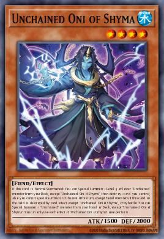   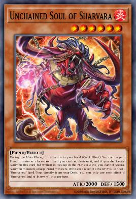   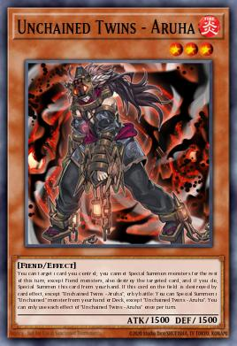   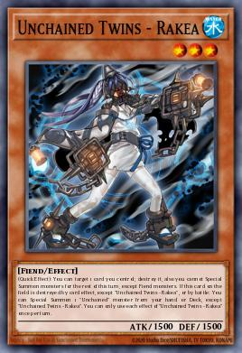 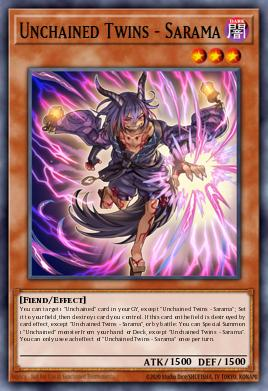 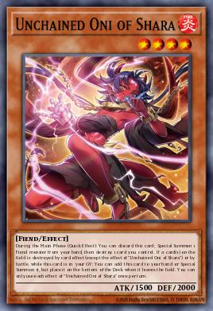 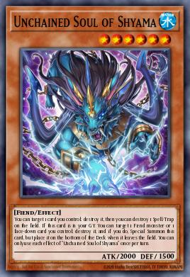 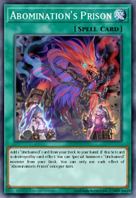   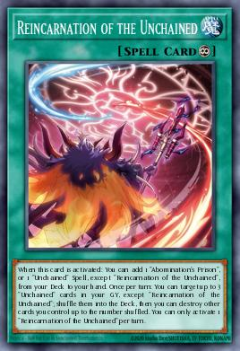   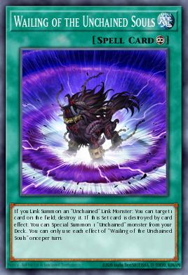 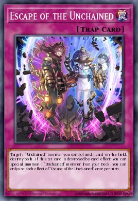 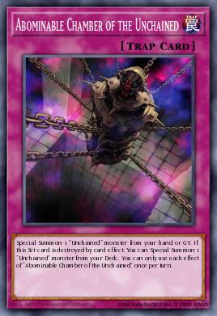 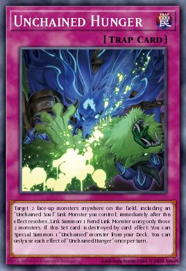 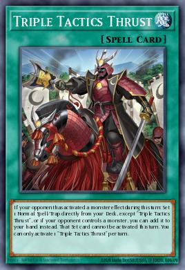   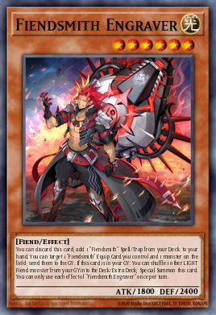 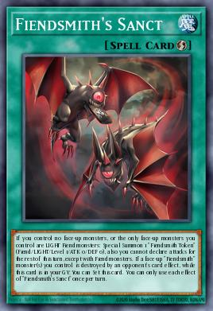    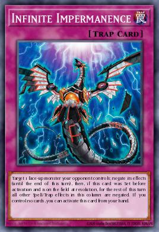       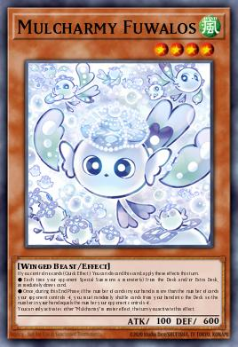   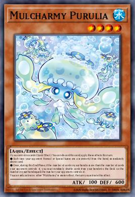  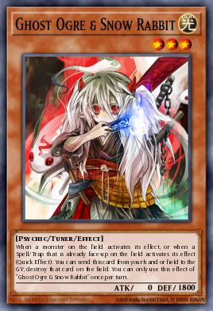  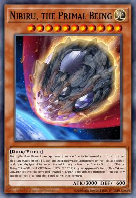  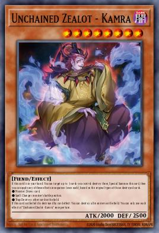 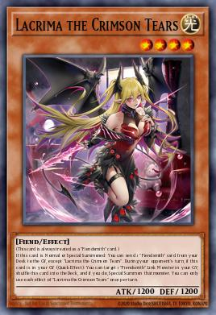 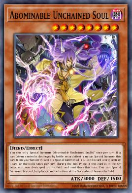 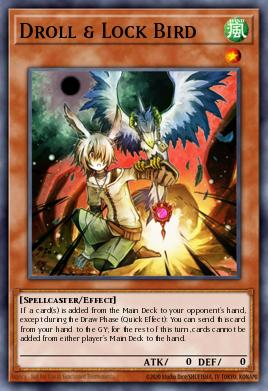

> [!deck] Extra Deck · 18
> 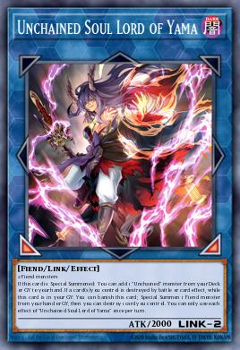  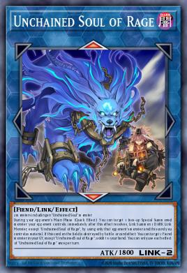 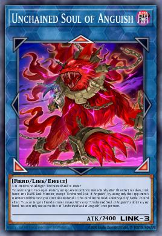 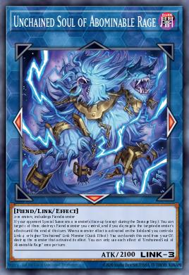 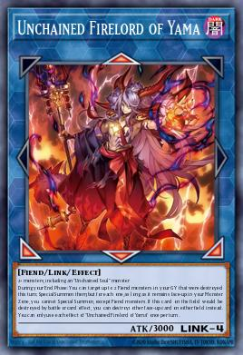 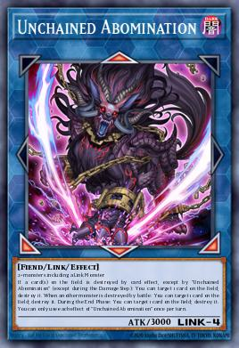  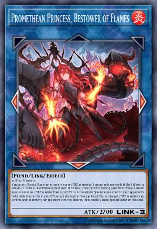 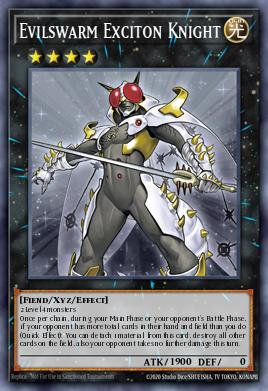 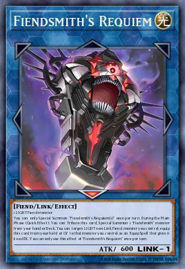 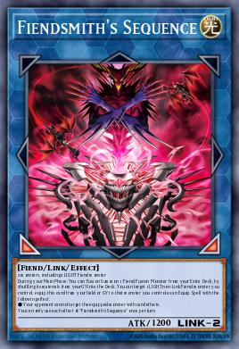 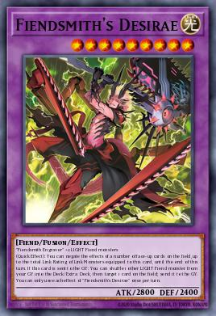 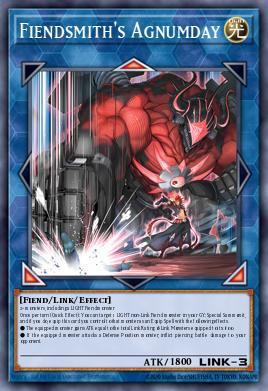 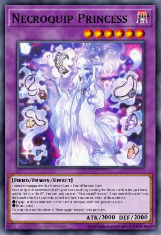 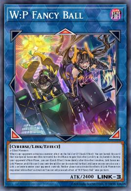 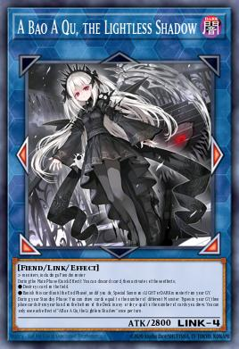 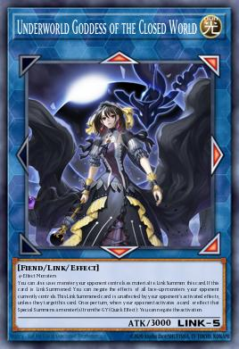

> [!deck] Side Deck · 9
> 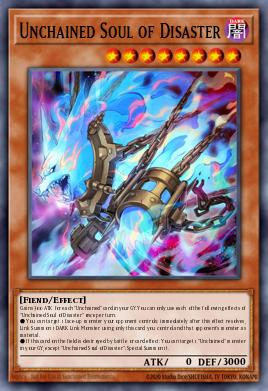  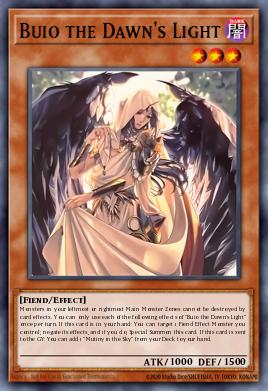 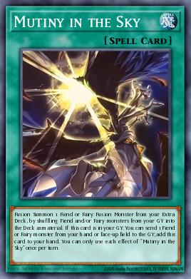 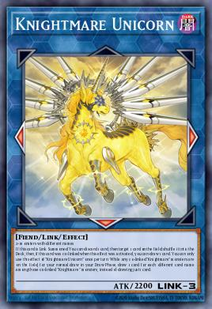 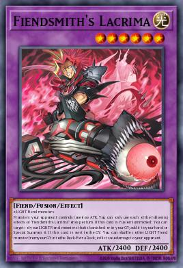   

> [!list]- Card list
> **Main**
> - 3× Unchained Ogre Shma
> - 3× Unchained Soul of Sharvara
> - 3× Unchained Twins - Aruha
> - 1× Unchained Twins - Rakea
> - 1× Unchained Twins - Sarama
> - 1× Unchained Ogre Shara
> - 1× Unchained Soul of Shyama
> - 3× Abomination's Prison
> - 3× Reincarnation of the Unchained
> - 1× Wailing of the Unchained Souls
> - 3× Escape of the Unchained
> - 1× Abominable Chamber of the Unchained
> - 1× Unchained Syncretism
> - 3× Triple Tactics Thrust
> - 3× Fiendsmith Engraver
> - 1× Fiendsmith's Sanct
> - 3× Ash Blossom & Joyous Spring
> - 3× Infinite Impermanence
> - 3× Mulcharmy Fuwalos
> - 2× Mulcharmy Purulia
> - 2× Ghost Ogre & Snow Rabbit
> - 2× Nibiru, the Primal Being
> - 1× Unchained Malevolent Magistrate Kamura
> - 1× Lacrima the Crimson Tears
> - 1× Abominable Unchained Soul
> - 1× Droll & Lock Bird
>
> **Extra**
> - 2× Unchained Soul Lord of Yama
> - 1× Unchained Soul of Rage
> - 1× Unchained Soul of Anguish
> - 1× Unchained Soul Rage Abominator
> - 1× Unchained Enma Lord Yama
> - 1× Unchained Abomination
> - 1× S:P Little Knight
> - 1× Promethean Princess, Bestower of Flames
> - 1× Evilswarm Exciton Knight
> - 1× Fiendsmith's Requiem
> - 1× Fiendsmith's Sequence
> - 1× Fiendsmith's Desirae
> - 1× Fiendsmith's Agnumday
> - 1× Necroquip Princess
> - 1× W:P Fancy Ball
> - 1× A Bao A Qu, the Lightless Shadow
> - 1× Underworld Goddess of the Closed World
>
> **Side**
> - 1× Unchained Soul of Disaster
> - 1× Abominable Unchained Soul
> - 1× Buio the Dawn's Light
> - 1× Mutiny in the Sky
> - 1× Knightmare Unicorn
> - 1× Fiendsmith's Lacrima
> - 1× Unchained Soul Lord of Yama
> - 1× Unchained Soul of Rage
> - 1× Unchained Soul Rage Abominator

## ⚔️ Combo 1 · Shma one-card (pure Unchained)

`🥇 Going first` · `Advanced` · `TCG` · `✅ Tested in Helios`

> [!hand] Starting hand · 1
> 
>
> **Unchained Ogre Shma**

| # | Card | Action | Choices |
|:-:|:-:|:--|:--|
| **1** |  | 🟢 **Normal Summon "Unchained Ogre Shma"** *One-card starter.* | ⚡ Use the effect of "Unchained Ogre Shma": Yes 👉 Select "Unchained Twins - Rakea" (from the Deck)  👉 Select "Unchained Twins - Rakea"  ⚡ Use the effect of "Unchained Twins - Rakea": Yes 👉 Select "Unchained Soul of Shyama" (from the Deck)  |
| **2** |  | 🔵 **Activate "Unchained Soul of Shyama" · Destroy 1 card you control** *SS Rakea from Deck, then destroy it so it floats. Rakea destroyed: SS Shyama from Deck. Field effect: destroy Shma.* | 👉 Select "Unchained Ogre Shma"  ⚡ Use the effect of "Unchained Ogre Shma": Yes 👉 Select "Unchained Soul of Sharvara" (from the Deck)  |
| **3** |  | 🟣 **Special Summon "Unchained Soul Lord of Yama" · way 1** *Shma destroyed: SS Sharvara from Deck. Core goal of every combo.* | 👉 Select "Unchained Soul of Sharvara"  👉 Select "Unchained Soul of Shyama"  |
| **4** |  | 🔵 **Activate "Unchained Soul Lord of Yama" · Add 1 "Unchained" monster from your Deck/GY to your hand** *CL1: search the other starter.* |  |
| **5** |  | 🔵 **Activate "Unchained Soul of Sharvara" · Set 1 "Unchained" Spell/Trap from your Deck** *CL2: Set Escape from Deck.* | 👉 Select "Escape of the Unchained" (from the Deck)  👉 Select "Unchained Twins - Aruha" (from the Deck)  |
| **6** |  | 🔵 **Activate "Unchained Twins - Aruha" · Destroy and summon** *Destroy set Escape, SS Aruha from hand. Skip Yama's GY effect.* | 👉 Select "Escape of the Unchained"  ⚡ Use the effect of "Escape of the Unchained": Yes 👉 Select "Unchained Soul of Sharvara" (from the Deck)  |
| **7** |  | 🟣 **Special Summon "Unchained Soul Rage Abominator"** *Set Escape destroyed: SS Sharvara from Deck. Link-3 (Yama counts as 2).* | 👉 Select "Unchained Soul of Sharvara"  👉 Select "Unchained Soul Lord of Yama"  👉 Finish the selection |
| **8** |  | 🔵 **Activate "Unchained Soul of Shyama" · Special Summon this card** *GY effect: destroy Aruha, SS Shyama.* | 👉 Select "Unchained Twins - Aruha"  |
| **9** |  | 🔵 **Activate "Unchained Twins - Aruha" · Special Summon** *Aruha floats into Sarama. Keep Yama's GY effect.* | 👉 Select "Unchained Twins - Sarama" (from the Deck)  |
| **10** |  | 🟣 **Special Summon "Unchained Soul of Rage"** *Link-2 (Abominator as 1). Shyama goes to bottom of Deck.* | 👉 Select "Unchained Soul of Shyama"  👉 Select "Unchained Soul Rage Abominator"  |
| **11** |  | 🔵 **Activate "Unchained Twins - Sarama" · Unchained Twins - Sarama** *Set Escape back from GY, destroy Rage.* | 👉 Select "Escape of the Unchained"  👉 Select "Unchained Soul of Rage"  |
| **12** |  | 🔵 **Activate "Unchained Soul of Rage" · Link Summon** *Rage destroyed: add Sharvara to hand (kept for follow-up).* | 👉 Select "Unchained Soul of Sharvara"  |
| **13** |  | 🔵 **Activate "Unchained Soul Lord of Yama" · Special Summon 1 Fiend monster from your hand/GY** *GY: banish, revive Abominator (no destroy) as Link-4 material.* | 👉 Select "Unchained Soul Rage Abominator"  ⚡ Answer: Yes 👉 Select "Unchained Twins - Sarama"  ⚡ Use the effect of "Unchained Twins - Sarama": Yes 👉 Select "Unchained Soul of Sharvara" (from the Deck)  |
| **14** |  | 🟣 **Special Summon "Unchained Enma Lord Yama"** *Link-4 (3+1).* | 👉 Select "Unchained Soul Rage Abominator"  👉 Select "Unchained Soul of Sharvara"  |
| **15** | ⏭️ | ⏭️ **End Phase** | ⚡ Use the effect of "Unchained Enma Lord Yama": Yes 👉 Select "Unchained Twins - Rakea", "Unchained Soul of Rage"   |

> [!board] End board · 4
>    
>
> **Unchained Twins - Rakea** · **Unchained Soul of Rage** · **Unchained Enma Lord Yama** · **Escape of the Unchained**
>
> ✋ 1 card(s) left in hand

> [!warning] Notes
> Optimal: set Reincarnation with Sharvara instead, search Prison, then the trap. Skull Meister is the only hand trap that matters on the Yama chain. Vs Imperm on Rage: Escape pops Rage, Yama in GY banishes to revive it. Very weak to Mulcharmy Fuwalos.

🎮 Helios: import `txt/unchained-complete-intro-guide-magnificent-maestros-archetype-overview_szWmBJ6QqNk_1.helios.txt` (Combos → Import) · ✅ played by the Helios trainer's Auto-play on 3 shuffles

## ⚔️ Combo 2 · Prison into Shma (Fiendsmith)

`🥇 Going first` · `Expert` · `TCG` · `✍️ Recorded in Helios · ✅ Tested`

> [!hand] Starting hand · 1
> 
>
> **Abomination's Prison**

| # | Card | Action | Choices |
|:-:|:-:|:--|:--|
| **1** |  | 🔵 **Activate "Abomination's Prison" · Abomination's Prison** | 👉 Select "Unchained Ogre Shma" (from the Deck)  |
| **2** |  | 🟢 **Normal Summon "Unchained Ogre Shma"** | ⚡ Use the effect of "Unchained Ogre Shma": Yes 👉 Select "Unchained Twins - Rakea" (from the Deck)  👉 Select "Unchained Twins - Rakea"  ⚡ Use the effect of "Unchained Twins - Rakea": Yes 👉 Select "Unchained Soul of Shyama" (from the Deck)  |
| **3** |  | 🔵 **Activate "Unchained Soul of Shyama" · Destroy 1 card you control** | 👉 Select "Unchained Ogre Shma"  ⚡ Use the effect of "Unchained Ogre Shma": Yes 👉 Select "Unchained Soul of Sharvara" (from the Deck)  |
| **4** |  | 🟣 **Special Summon "Unchained Soul Lord of Yama" · way 1** | 👉 Select "Unchained Soul of Sharvara"  👉 Select "Unchained Soul of Shyama"  |
| **5** |  | 🔵 **Activate "Unchained Soul Lord of Yama" · Add 1 "Unchained" monster from your Deck/GY to your hand** |  |
| **6** |  | 🔵 **Activate "Unchained Soul of Sharvara" · Set 1 "Unchained" Spell/Trap from your Deck** | 👉 Select "Escape of the Unchained" (from the Deck)  👉 Select "Unchained Twins - Aruha" (from the Deck)  |
| **7** |  | 🔵 **Activate "Unchained Twins - Aruha" · Destroy and summon** | 👉 Select "Escape of the Unchained"  ⚡ Use the effect of "Escape of the Unchained": Yes 👉 Select "Unchained Ogre Shara" (from the Deck)  |
| **8** |  | 🟣 **Special Summon "Unchained Soul Rage Abominator"** | 👉 Select "Unchained Soul Lord of Yama"  👉 Select "Unchained Ogre Shara"  👉 Finish the selection |
| **9** |  | 🔵 **Activate "Unchained Soul of Shyama" · Special Summon this card** | 👉 Select "Unchained Twins - Aruha"  |
| **10** |  | 🔵 **Activate "Unchained Twins - Aruha" · Special Summon** |  |
| **11** |  | 🔵 **Activate "Unchained Ogre Shara" · Special Summon this card or add it to your hand** |  |
| **12** |  | 🔵 **Activate "Unchained Soul Lord of Yama" · Special Summon 1 Fiend monster from your hand/GY** | 👉 Select "Unchained Soul of Sharvara"  ⚡ Answer: No 🔀 Choose: Special Summon it  👉 Select "Unchained Twins - Sarama" (from the Deck)  |
| **13** |  | 🟣 **Special Summon "Unchained Soul of Rage"** | 👉 Select "Unchained Soul of Shyama"  👉 Select "Unchained Soul of Sharvara"  |
| **14** |  | 🔵 **Activate "Unchained Twins - Sarama" · Unchained Twins - Sarama** | 👉 Select "Escape of the Unchained"  👉 Select "Unchained Soul of Rage"  ⚡ Use the effect of "Unchained Soul of Rage": Yes 👉 Select "Unchained Soul of Sharvara"  |
| **15** |  | 🔵 **Activate "Unchained Soul of Sharvara" · Special Summon this card** | 👉 Select "Unchained Twins - Sarama"  ⚡ Use the effect of "Unchained Twins - Sarama": Yes 👉 Select "Unchained Ogre Shma" (from the Deck)  |
| **16** |  | 🟣 **Special Summon "Unchained Enma Lord Yama"** | 👉 Select "Unchained Soul of Sharvara"  👉 Select "Unchained Soul Rage Abominator"  👉 Finish the selection |
| **17** |  | 🟣 **Special Summon "Evilswarm Exciton Knight"** | 👉 Select "Unchained Ogre Shma"  👉 Select "Unchained Ogre Shara"  |
| **18** |  | 🟣 **Special Summon "Fiendsmith's Requiem"** | 👉 Select "Evilswarm Exciton Knight"  |
| **19** |  | 🔵 **Activate "Fiendsmith's Requiem" · Special Summon 1 "Fiendsmith" monster** | 👉 Select "Lacrima the Crimson Tears" (from the Deck)  ⚡ Use the effect of "Lacrima the Crimson Tears": Yes 👉 Select "Fiendsmith Engraver" (from the Deck)  |
| **20** |  | 🔵 **Activate "Fiendsmith's Requiem" · Equip this card to 1 non-Link LIGHT Fiend you control** | 👉 Select "Lacrima the Crimson Tears"  |
| **21** |  | 🔵 **Activate "Fiendsmith Engraver" · Special Summon this card** | 👉 Select "Evilswarm Exciton Knight"  |
| **22** |  | 🟣 **Special Summon "Fiendsmith's Sequence"** | 👉 Select "Lacrima the Crimson Tears"  👉 Select "Fiendsmith Engraver"  |
| **23** |  | 🔵 **Activate "Fiendsmith's Sequence" · Fusion Summon 1 Fiend Fusion Monster** | 👉 Select "Fiendsmith's Desirae"  👉 Select "Fiendsmith's Requiem"  👉 Select "Lacrima the Crimson Tears"  👉 Select "Fiendsmith Engraver"  |
| **24** |  | 🔵 **Activate "Fiendsmith's Sequence" · Equip this card to 1 non-Link LIGHT Fiend you control** | 👉 Select "Fiendsmith's Desirae"  |
| **25** | ⏭️ | ⏭️ **End Phase** |  |
| **26** |  | 🔵 **Activate "Unchained Enma Lord Yama" · Special Summon up to 2 Fiend monsters from your GY** | 👉 Select "Unchained Twins - Rakea", "Unchained Soul of Rage"   |

> [!board] End board · 6
>      
>
> **Fiendsmith's Desirae** · **Unchained Soul of Rage** · **Unchained Enma Lord Yama** · **Fiendsmith's Sequence** · **Unchained Twins - Rakea** · **Escape of the Unchained**
>
> ✋ 1 card(s) left in hand

> [!warning] Notes
> Higher ceiling, less follow-up than pure (no Yama in GY, no Sharvara in hand). Requires 2 Level 4s for Exciton Knight bridge.

🎮 Helios: import `txt/unchained-complete-intro-guide-magnificent-maestros-archetype-overview_szWmBJ6QqNk_2.helios.txt` (Combos → Import) · ✅ played by the Helios trainer's Auto-play on 3 shuffles

## ⚔️ Combo 3 · Aruha + trap into Shma

`🥇 Going first` · `Expert` · `TCG` · `✅ Tested in Helios`

> [!hand] Starting hand · 2
>  
>
> **Unchained Twins - Aruha** · **Escape of the Unchained**

| # | Card | Action | Choices |
|:-:|:-:|:--|:--|
| **1** |  | 🟤 **Set "Escape of the Unchained"** *Set the starter trap.* |  |
| **2** |  | 🔵 **Activate "Unchained Twins - Aruha" · Destroy and summon** *Pop set Escape, SS Aruha (Fiend lock).* | 👉 Select "Escape of the Unchained"  ⚡ Use the effect of "Escape of the Unchained": Yes 👉 Select "Unchained Soul of Shyama" (from the Deck)  |
| **3** |  | 🔵 **Activate "Unchained Soul of Shyama" · Destroy 1 card you control** *Set Escape destroyed: SS Shyama from Deck. Destroy Aruha.* | 👉 Select "Unchained Twins - Aruha"  ⚡ Use the effect of "Unchained Twins - Aruha": Yes 👉 Select "Unchained Soul of Sharvara" (from the Deck)  |
| **4** |  | 🟣 **Special Summon "Unchained Soul Lord of Yama" · way 1** *Aruha floats into Sharvara. Link-2 with both Level 6s.* | 👉 Select "Unchained Soul of Sharvara"  👉 Select "Unchained Soul of Shyama"  |
| **5** |  | 🔵 **Activate "Unchained Soul Lord of Yama" · Add 1 "Unchained" monster from your Deck/GY to your hand** *Search Shma.* |  |
| **6** |  | 🔵 **Activate "Unchained Soul of Sharvara" · Set 1 "Unchained" Spell/Trap from your Deck** *Sharvara in GY: set Syncretism.* | 👉 Select "Unchained Syncretism" (from the Deck)  👉 Select "Unchained Ogre Shma" (from the Deck)  |
| **7** |  | 🟢 **Normal Summon "Unchained Ogre Shma"** *Normal Summon Shma.* | ⚡ Use the effect of "Unchained Ogre Shma": Yes 👉 Select "Unchained Twins - Rakea" (from the Deck)  👉 Select "Unchained Twins - Rakea"  ⚡ Use the effect of "Unchained Twins - Rakea": Yes 👉 Select "Unchained Ogre Shara" (from the Deck)  |
| **8** |  | 🟣 **Special Summon "Unchained Soul Rage Abominator"** *SS Rakea, destroy it. Rakea floats into Shara. Link-3 Abominator with 3 materials (Yama counted as 1).* | 👉 Select "Unchained Ogre Shma"  👉 Select "Unchained Ogre Shara"  👉 Select "Unchained Soul Lord of Yama"  |
| **9** |  | 🔵 **Activate "Unchained Soul of Shyama" · Special Summon this card** *GY: destroy Abominator, revive Shyama.* | 👉 Select "Unchained Soul Rage Abominator"  |
| **10** |  | 🔵 **Activate "Unchained Ogre Shara" · Special Summon this card or add it to your hand** *GY trigger: Special Summon Shara itself (not add to hand).* |  |
| **11** |  | 🔵 **Activate "Unchained Soul Lord of Yama" · Special Summon 1 Fiend monster from your hand/GY** *Banish: SS Shma from GY, then destroy Shma.* | 👉 Select "Unchained Ogre Shma"  ⚡ Answer: Yes 👉 Select "Unchained Ogre Shma"  🔀 Choose: Special Summon it  ⚡ Use the effect of "Unchained Ogre Shma": Yes 👉 Select "Unchained Twins - Sarama" (from the Deck)  |
| **12** |  | 🟣 **Special Summon "Unchained Soul of Rage"** *Shma floats into Sarama. Link-2 Rage.* | 👉 Select "Unchained Soul of Shyama"  👉 Select "Unchained Ogre Shara"  |
| **13** |  | 🔵 **Activate "Unchained Twins - Sarama" · Unchained Twins - Sarama** *Set Escape from GY, destroy set Syncretism.* | 👉 Select "Escape of the Unchained"  👉 Select "Unchained Syncretism"  ⚡ Use the effect of "Unchained Syncretism": Yes 👉 Select "Unchained Soul of Sharvara" (from the Deck)  |
| **14** |  | 🟣 **Special Summon "Unchained Enma Lord Yama"** *Set Syncretism destroyed: SS Sharvara from Deck. Link-4 Enma Lord Yama (Rage 2 + 2).* | 👉 Select "Unchained Soul of Sharvara"  👉 Select "Unchained Twins - Sarama"  👉 Select "Unchained Soul of Rage"  |
| **15** | ⏭️ | ⏭️ **End Phase** *End Phase.* | ⚡ Use the effect of "Unchained Enma Lord Yama": Yes 👉 Select "Unchained Ogre Shma", "Unchained Twins - Rakea"   |

> [!board] End board · 4
>    
>
> **Unchained Twins - Rakea** · **Unchained Ogre Shma** · **Unchained Enma Lord Yama** · **Escape of the Unchained**

> [!warning] Notes
> Pure variant: keep Sharvara in hand, don't pop Sarama, just link into the Link-4 Yama.

🎮 Helios: import `txt/unchained-complete-intro-guide-magnificent-maestros-archetype-overview_szWmBJ6QqNk_3.helios.txt` (Combos → Import) · ✅ played by the Helios trainer's Auto-play on 3 shuffles

## ⚔️ Combo 4 · Sharvara + trap into Shma (Agnumday)

`🥇 Going first` · `Expert` · `TCG` · `✍️ Recorded in Helios · ✅ Tested`

> [!hand] Starting hand · 2
>  
>
> **Unchained Soul of Sharvara** · **Unchained Syncretism**

| # | Card | Action | Choices |
|:-:|:-:|:--|:--|
| **1** |  | 🟤 **Set "Unchained Syncretism"** |  |
| **2** |  | 🔵 **Activate "Unchained Soul of Sharvara" · Special Summon this card** | 👉 Select "Unchained Syncretism"  ⚡ Use the effect of "Unchained Syncretism": Yes 👉 Select "Unchained Soul of Shyama" (from the Deck)  |
| **3** |  | 🟣 **Special Summon "Unchained Soul Lord of Yama" · way 1** | 👉 Select "Unchained Soul of Sharvara"  👉 Select "Unchained Soul of Shyama"  |
| **4** |  | 🔵 **Activate "Unchained Soul Lord of Yama" · Add 1 "Unchained" monster from your Deck/GY to your hand** |  |
| **5** |  | 🔵 **Activate "Unchained Soul of Sharvara" · Set 1 "Unchained" Spell/Trap from your Deck** | 👉 Select "Escape of the Unchained" (from the Deck)  👉 Select "Unchained Ogre Shma" (from the Deck)  |
| **6** |  | 🟢 **Normal Summon "Unchained Ogre Shma"** | ⚡ Use the effect of "Unchained Ogre Shma": Yes 👉 Select "Unchained Twins - Aruha" (from the Deck)  👉 Select "Unchained Twins - Aruha"  ⚡ Use the effect of "Unchained Twins - Aruha": Yes 👉 Select "Unchained Twins - Rakea" (from the Deck)  |
| **7** |  | 🔵 **Activate "Unchained Twins - Rakea" · Destroy and summon** | 👉 Select "Unchained Ogre Shma"  ⚡ Use the effect of "Unchained Ogre Shma": Yes 👉 Select "Unchained Ogre Shara" (from the Deck)  |
| **8** |  | 🟣 **Special Summon "Unchained Soul Rage Abominator"** | 👉 Select "Unchained Soul Lord of Yama"  👉 Select "Unchained Ogre Shara"  👉 Finish the selection |
| **9** |  | 🔵 **Activate "Unchained Soul of Shyama" · Special Summon this card** | 👉 Select "Escape of the Unchained"  |
| **10** |  | 🔵 **Activate "Escape of the Unchained" · Escape of the Unchained** |  |
| **11** |  | 🔵 **Activate "Unchained Ogre Shara" · Special Summon this card or add it to your hand** |  |
| **12** |  | 🔵 **Activate "Unchained Soul Lord of Yama" · Special Summon 1 Fiend monster from your hand/GY** | 👉 Select "Unchained Soul of Sharvara"  ⚡ Answer: No 🔀 Choose: Special Summon it  👉 Select "Unchained Twins - Sarama" (from the Deck)  |
| **13** |  | 🔵 **Activate "Unchained Soul of Shyama" · Destroy 1 card you control** | 👉 Select "Unchained Twins - Rakea"  ⚡ Use the effect of "Unchained Twins - Rakea": Yes 👉 Select "Unchained Ogre Shma" (from the Deck)  |
| **14** |  | 🟣 **Special Summon "Unchained Soul of Rage"** | 👉 Select "Unchained Soul of Shyama"  👉 Select "Unchained Soul of Sharvara"  |
| **15** |  | 🔵 **Activate "Unchained Twins - Sarama" · Unchained Twins - Sarama** | 👉 Select "Escape of the Unchained"  👉 Select "Unchained Soul of Rage"  ⚡ Use the effect of "Unchained Soul of Rage": Yes 👉 Select "Unchained Twins - Aruha"  |
| **16** |  | 🔵 **Activate "Unchained Twins - Aruha" · Destroy and summon** | 👉 Select "Unchained Twins - Sarama"  ⚡ Use the effect of "Unchained Twins - Sarama": Yes 👉 Select "Unchained Soul of Shyama" (from the Deck)  |
| **17** |  | 🟣 **Special Summon "Unchained Enma Lord Yama"** | 👉 Select "Unchained Soul Rage Abominator"  👉 Select "Unchained Soul of Shyama"  👉 Finish the selection |
| **18** |  | 🟣 **Special Summon "Evilswarm Exciton Knight"** | 👉 Select "Unchained Ogre Shara"  👉 Select "Unchained Ogre Shma"  |
| **19** |  | 🟣 **Special Summon "Fiendsmith's Requiem"** | 👉 Select "Evilswarm Exciton Knight"  |
| **20** |  | 🔵 **Activate "Fiendsmith's Requiem" · Special Summon 1 "Fiendsmith" monster** | 👉 Select "Lacrima the Crimson Tears" (from the Deck)  ⚡ Use the effect of "Lacrima the Crimson Tears": Yes 👉 Select "Fiendsmith Engraver" (from the Deck)  |
| **21** |  | 🟣 **Special Summon "Fiendsmith's Sequence"** | 👉 Select "Lacrima the Crimson Tears"  👉 Select "Unchained Twins - Aruha"  |
| **22** |  | 🔵 **Activate "Fiendsmith's Sequence" · Fusion Summon 1 Fiend Fusion Monster** | 👉 Select "Fiendsmith's Desirae"  👉 Select "Fiendsmith Engraver"  👉 Select "Evilswarm Exciton Knight"  👉 Select "Fiendsmith's Requiem"  |
| **23** |  | 🔵 **Activate "Fiendsmith's Sequence" · Equip this card to 1 non-Link LIGHT Fiend you control** | 👉 Select "Fiendsmith's Desirae"  |
| **24** | ⏭️ | ⏭️ **End Phase** |  |
| **25** |  | 🔵 **Activate "Unchained Enma Lord Yama" · Special Summon up to 2 Fiend monsters from your GY** | 👉 Select "Unchained Twins - Rakea", "Unchained Soul of Rage"   |

> [!board] End board · 6
>      
>
> **Fiendsmith's Desirae** · **Unchained Soul of Rage** · **Unchained Enma Lord Yama** · **Fiendsmith's Sequence** · **Unchained Twins - Rakea** · **Escape of the Unchained**
>
> ✋ 1 card(s) left in hand

> [!warning] Notes
> Starting with Sharvara limits you since it's needed later to pop from hand. If Desirae is cleared, Lacrima in GY can bring it back.

🎮 Helios: import `txt/unchained-complete-intro-guide-magnificent-maestros-archetype-overview_szWmBJ6QqNk_4.helios.txt` (Combos → Import) · ✅ played by the Helios trainer's Auto-play on 3 shuffles

## 📝 Video notes

### Notes

### Archetype overview

Unchained gets new support in Magnificent Maestros: new starters, new extenders and more. It is one of the coolest archetypes because of its unique way of interrupting: using the opponent's monsters as Link Material, then link climbing into powerful Fiend-locked Link monsters. You have a decent amount of room for non-engine, and can play with or without **Fiendsmith**. With Fiendsmith you get some nice extenders. Without it you can play **Dominus Impulse**, because the Unchained engine does not conflict with it and runs DARK, FIRE and WATER monsters.

> [!warning]
> One of the biggest downsides is that the deck plays very hard into **Fuwalos**. Basically every extension is a summon from the deck or the Extra Deck, so if you get hit with Fuwalos you are stopped on the spot and have to pass the turn. **Droll & Lock Bird**-style effects are not a big deal. **Mulcharmy Purulia** and **Mulcharmy Meowls** are also a little tough, but you only give them one or two draws for each of those. Joel and Lothbird (as named in the transcript) is not really a big deal.

- You can fit anywhere from 10 to 15 non-engine cards, depending on which supplementary engines or extenders you play.
- Your follow-up is generally pretty decent: a few pieces can summon themselves back from the GY, and it is easy to recycle Unchained pieces with the new support.

### General rule of the main deck monsters

> [!important]
> For all Unchained monsters, if they get destroyed off the board, they summon another Unchained monster from your deck, ==once per turn per name==. There are a few exceptions, but you generally want to destroy your own stuff so it floats into the monsters you want.

> [!important]
> Every combo starts the same way: ==first goal, first action, summon **Unchained Soul Lord of Yama**==, which searches any Unchained card from deck to hand. This means getting two Unchained monsters on board: summon one Unchained monster and destroy it with another Unchained monster so you get two bodies on the board at the same time. Depending on how you started, you search the other extender.

### Level 3s

- **Unchained Aruha**: while in your hand, it can destroy something (e.g. a monster or an Unchained Spell/Trap you put on the board) and summon itself. Whatever was destroyed summons another Unchained monster, giving two monsters on board. Early-combo card / two-card starter.
- **Unchained Rakea**: destroys any card on your board from the field. E.g. normal summon Rakea, set an Unchained Spell/Trap, and Rakea pops it. The Spell/Trap summons another monster, so you get two monsters on board. Early-combo card / semi-starter. Also quick effect: target something you control and destroy it.
- **Unchained Sarama**: later-combo piece. Puts a Spell/Trap back from your GY onto your field, then destroys something on your field, so it extends. You generally burn one of your Spell/Trap destructions earlier, then bring out Sarama later to bring it back. This is how you set up whichever Spell/Trap you want in your end board.

Combos are pretty linear. Depending on which monster you start with, it is just a question of how you destroy something to get two bodies on the board.

### Level 4s (new in Magnificent Maestros)

- **Unchained Shma**: on summon, summons another Unchained from your deck. This is the one-card starter: Aruha and Rakea need you to destroy another card to get two bodies, while Shma summons one straight out of the deck. Excellent piece of support, early in the combo.
- **Unchained Shara**: an extender from the GY that revives itself later in the combo.

Starters and early extenders sit on the left, later-combo extenders on the right: many cards you just want in the GY for later, or want to destroy so they come back later.

### Level 6s (the stars of the main deck)

- **Unchained Shavara**: if it goes to the GY, you can set any Unchained Spell/Trap to your back row. This is very important, not only because the Spell/Trap may be good with its effect, but also because you may need something new to destroy to extend, so it gets you an extender. It also has an effect to summon itself from your hand by destroying something on the field, similar to Aruha but a ==quick effect==. Best extender / utility piece.
- **Unchained Shiyama** (unique to Unchained, maybe a little tier-limited): goes in the right-side (later) category. When in your GY, you can destroy something on your board to summon itself back out. On the board, it can destroy something for free, and can pop a Spell/Trap on either side of the field, so it also gives some clearance. Extender from the GY.

### Level 8s (not that good in 2026)

They have some utility, but are niche and expensive. They do not fit the starter/extender categories.

- **Unchained Soul of Disaster**: links up into a Link-2 using one of your opponent's monsters. Going first it is dead, since the opponent has no monsters. At most a side deck card for going second.
- **Abominable Unchained Soul**: decent interruption. If something on the board is destroyed, you can summon it. When summoned, discard a card to pop any card on the board. It floats itself, but the discard cost is expensive, and you have to already be playing for it to extend when going first.
- **Unchained Malevolent Magistrate Kimura** (new): ignition effect in the hand. Destroy up to three cards, with a different effect depending on card type: a monster means draw a card, a Spell means change the battle position of something on the field, and a Trap means destroy another card on the field. It is not a quick effect, so it is just a going-second board breaker. You have to destroy cards you control to summon it and get the effect, and you can only pop one of the opponent's cards if you destroy a Trap, so it is not realistically a board breaker. Cool, very niche interactions, but mid for competitive play.

> [!warning]
> The creator does not recommend playing any of these level 8s in the main deck, even in a completely pure Unchained build.

### Spells

- **Abominations Prison**: not "Unchained" in the name, so you cannot set it with **Unchained Shavara**, for example. Searches any Unchained card to hand.
- **Reincarnation of the Unchained**: searches **Abominations Prison**. Also recycles Unchained monsters from your GY back into your deck. This matters because going first you cycle through a ton of your cards and try to destroy every name in your deck, so your main deck is thinned out. If you need follow-up or make it to turn three, you have to put these names back to do it all again. It can also set any other Unchained Spell, but you are probably not playing any other.
- **Wailing of the Unchained Souls**: continuous Spell. If you link summon, destroy any card on the field once per turn. It is okay, kind of a brick. Going first there are no opposing cards to destroy with it, so you just set it to your back row and destroy it, and it floats: if destroyed while set, you can summon out an Unchained. So it is not a brick going first. It is also okay going second: place it and start linking to clear the opponent's board, but that probably will not resolve, so you will want another board breaker. "Just whatever."

### Traps

- **Abominable Chamber**: just Monster Reader / Call of the Haunted-style, for four Unchained monsters.
- **Escape of the Unchained**: target one Unchained you control and one card your opponent controls and destroy them both. Also destroys Spells/Traps, which is nice. The creator's favorite trap.
- **Unchained Syncretism**: target two monsters on the field, including an Unchained Soul Link monster you control, and link summon using it and one of the opponent's monsters you target. It is a link climb and monster removal from your opponent. It is kind of a backup, since **Unchained Soul of Rage** already does this: e.g. if Rage is negated, or if Rage links into a Link-3 with an opponent's monster and Syncretism then uses that Link-3 with another opponent's monster to go into a Link-4.

If you get both Escape and Syncretism, that is two removals, which is why one of each is played.

> [!important]
> All Unchained Spells/Traps, if set and destroyed, summon an Unchained monster from your deck. If you pop them with Aruha, Rakea or Shavara (the most common ones), don't worry about losing your Spell/Trap interruptions: ==**Unchained Sarama** will put them back to your board==.

### Extra Deck

Most of these Links lock you into summoning Fiends.

> [!warning]
> ==Fiend lock==: if you use **Unchained Aruha**, **Unchained Rakea** and so on, you are locked into summoning Fiends. The new Link-4 Yama restricts you to Fiends too, as does **Unchained Shavara** while on your board. Generally you are locked into Fiends the whole time, so you want to supplement the deck with other good Fiend support monsters.

- **Unchained Soul of Rage**: on your opponent's turn only. Be careful, sometimes you will be Fiend-locked while Rage is on the board, so you cannot go into SP, but there are other options.
- **Unchained Enma Lord Yama** + **Unchained Rakea** end board: Rakea is a quick effect that targets something you control and destroys it. With Yama plus Rakea on your opponent's turn, you can go at any time you want: Rakea targets your own Yama (Link-4), Yama says "instead of being destroyed, I destroy one of my opponent's cards". This turns Rakea into an interruption. In the End Phase, Yama brings back what you destroyed, so you link climb, destroy your best stuff, and revive it at the end.
- If your opponent summons another Link-2, you can go directly up into a Link-4 such as **Unchained Abomination** and start popping more stuff, so you have some cool link climbing options.
- The deck profile also shows other Fiend Link monsters you can consider.

### Deck profile: pure Unchained list

- 3x **Unchained Shma**: best starter, normal summon, one-card combo.
- 3x **Unchained Shavara**, 3x **Unchained Aruha**: best alternate starters, two-card starters because they pair with basically any other Unchained card.
- 1x **Unchained Shara**, 1x **Unchained Rakea**, 1x **Unchained Sarama**: the one-ofs. You start with the starters and turbo out all the one-ofs so they fulfill their niche interactions.
- 3x **Abominations Prison**, 3x **Reincarnation of the Unchained**: also one-card starters since they get you to Shma. Paired with any of the others, they are a full extension.
- 1x **Wailing of the Unchained Souls**: just for fun, you can cut it.
- 1 each of the traps. The creator considered two or more traps; the favorite trap is **Escape of the Unchained**, and the second Escape was cut for Wailing. You can put the other Escape back, but since Wailing is searchable with Reincarnation and fulfills the same purpose as Escape when building a board (set it and pop it), the flexibility was preferred.
- 17 non-engine cards.

> [!example] Non-engine pick: Tactics Thrust
> The creator points out 3x **Tactics Thrust**. Unchained is the best deck for it: if you get interrupted going first, Thrust can set one of the Unchained traps, which serves as an extender because you then pop it with whatever resource you have. Build your side deck considering you have Thrust. The rest is standard non-engine, whatever you want to play (e.g. **Gap**, if you want to play it).

The video also mentions a second list with a little **Fiendsmith** involved, where the non-engine is swapped out for more engine, plus other interesting options for main deck or non-engine swaps. That content is not included in this transcript.

### Notes

- **Impulse** is only worth playing with **Gallant**; otherwise **Gallant** is just a Lava Golem.
- Level 8s in the side are only options you can play if you really want to.
- **Promethean Princess, Bestower of Flames**: an Extra Deck card for the Fiendsmith version. You can go into Promethean because you have Fire monsters, and you can summon back **Sharvara** or **Aruha**. The caveat is that you are ==locked into Fire monsters while Princess is on the board==, and there is no good rank or link for Fire. With Fiendsmith you have **Desiree** on board, so you can ==negate your own Promethean with Desiree and then link it off==. You can also summon Promethean and then link into **Nightmare Phoenix** and link down; in that case cut **SP Little Knight**.
- **Buio the Dawn's Light**: a Fiend extender. If you have a Fiend on board, summon it; when it goes to the GY it searches **Mutiny in the Sky**, which is a Miracle Fusion that Fusion Summons a Fiend using materials from your GY. You can summon **Luce** or **Duke of Demise**. **Luce** uses three Fiends, puts them back in your deck, and starts popping stuff. **Duke of Demise** gives an extra Normal Summon and adds a Fiend from the GY to your hand. I would like to fit Buio and one Mutiny, but don't know what to cut, so it will take playtesting.
- Extra Deck (pure build): **SP Little Knight** for the off chance you end on Rage (Rage into SP is not terrible); triple **Yama** (summon it every turn); one of each Link 4; one **Anguish** Link 3; two of the other Link 3 (some combos summon it twice); **Promethean** for now.
- **Nightmare Unicorn**: it's a Fiend monster and sometimes you are Fiend-locked and need to link-remove. Also, whenever you summon back **Rage**, you can only summon Fiends while you control it. If you go Link 4 **Yama**, summon back Rage, you cannot Rage into SP; you must Rage into something else, maybe another removal, which is why Unicorn is here.
- Other Extra Deck cards: **Evil Storm**, **Exiton Knight** (Rank 4 Fiend board, solid). Exiton Knight is also your **Fiendsmith bridge**.
- Fiendsmith build: very similar; cut the **Impulses** because of the Fiendsmith stuff. Play one **Engraver**, one **Lacrima**, one **Sanct** (Sanct is fine in this deck; I don't want to play the Lurry Brick). ==You cannot cut to one Engraver anymore because **DDD Wave High King Caesar** is now banned==; to summon **Desiree** at minimum you need these two. Sanct is also in case you draw Engraver, so it's not completely dead.
- Fiendsmith Extra Deck: **Exiton Knight** (bridge), **Requiem**, **Agnumday**, **Necroquip**, **Desiree**. No DDD Wave High King Caesar needed anymore. Cut one **Yama** and one Link 3, plus the Nightmare cards.
- Alternative Fiendsmith bridge: the **Gin Rank 3** (light one, **Mellow Melody**). Your deck has Level 3s and Level 4s, but later in your combo it's much easier to get two Level 4s on board for Exiton than two Level 3s for Mellow Melody, because Level 4 **Shara** summons itself back from the GY easily. So I depend on the Rank 4 bridge for Fiendsmith lines.

> [!warning] Hand traps and interruptions
> - **Skullmeister** is the only hand trap that matters on the Yama chain (Yama CL1, Sharvara CL2); it protects Yama from **Ogre** and **Ash**.
> - If the opponent uses **Imperm** on Unchained Soul of Rage (draw phase), you can't link off. Use **Escape**, pop Rage, pop one of the opponent's cards on resolution; **Yama** banishes and summons back Rage, which is no longer negated.
> - You can do the same kind of backup with **Sharvara**. There are a lot of layers.

> [!important] Starter and combo comparison
> - Your other starter besides **Shma** is **Aruha** or **Sharvara** + trap. Combo into **Yama**, then Yama/Sharvara into the other starter.
> - Shma starter: summon all blue monsters first, then the red ones.
> - The pure Unchained line is ==lower ceiling but more resilient==; the Fiendsmith line is ==higher risk, higher reward==.
> - **Sharvara** is often needed later in the combo to pop stuff from your hand, which is why starting with it limits you.

- The creator originally recorded all replays with **DDD Wave High King Caesar** and will remake them after the ban list.
- Unchained is expected in **Maximum Crisis**-era product; hope it doesn't get destroyed by **Charmies** or limited too much by the DDD Wave High King Caesar hit. The creator asks viewers to comment if they are excited and want more Unchained combos or content.
